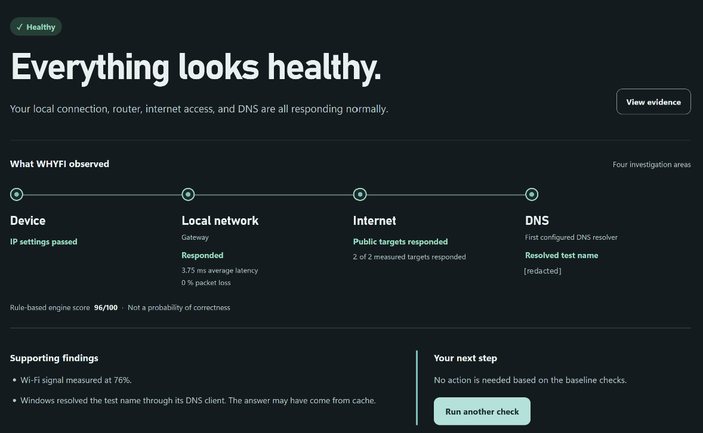

# WHYFI

WHYFI is a local-first Windows desktop app for diagnosing network connectivity. It checks your device, gateway, public IP reachability, and DNS, then explains where the evidence points. When the available evidence cannot support a reliable conclusion, it reports an inconclusive result.



*Real Windows diagnosis in the Checkline Result workspace. A private resolver address is redacted; all other displayed measurements are from the captured run.*

More views: [Diagnose](docs/screenshots/whyfi-diagnose-dark.png) · [Technical Evidence](docs/screenshots/whyfi-evidence-dark.png) · [Full Result window](docs/screenshots/whyfi-result-dark-full.png).

## What it does

- **Diagnose** checks the active Windows adapter, IPv4 configuration, Wi-Fi signal where available, gateway response, public ICMP targets, and DNS resolution.
- **Result** shows the rule-based conclusion, supporting measurements, and a next action when available. The engine score is a rule-based indicator. Missing measurements stay distinct from measured zero or a confirmed failure.
- **Evidence** shows device and local network details, per-target internet measurements, and DNS evidence. It separates the Windows DNS-client lookup, direct primary-interface resolver queries, and resolver inventory on other interfaces.

The desktop streams progress as checks run and supports cancellation, an overall timeout, and retry. Its appearance can follow Windows or be explicitly set to Light or Dark; that preference is saved locally. The [CLI guide](docs/diagnostics.md) covers baseline checks, deeper connection-quality testing, and JSON output.

## How it works

React and TypeScript render the WebView2 workspace. Tauri 2 exposes start and cancel commands to the main window. Rust manages a single active investigation, supervises the fixed Python sidecar, and validates bounded newline-delimited JSON. Python collects Windows evidence and owns the diagnosis rules.

The [architecture guide](docs/architecture.md) maps the request and evidence flow, process ownership, and protocol limits to the implementation.

## Validation and distribution

[GitHub Actions](.github/workflows/ci.yml) runs deterministic Python diagnostics and packaging regressions on Windows, frontend tests and a TypeScript/Vite build on Linux, and locked Rust checks and protocol/lifecycle tests on Windows. The Rust job runs without a packaged sidecar. Browser tests and native WebView2 smoke checks cover the workspace separately from installer acceptance.

A **private, unsigned Windows x64 NSIS candidate** for **0.1.0** was built from clean commit [`8d5fe9e`](https://github.com/danielguillaumont/whyfi/commit/8d5fe9eb00909d9f5d7a6ad038686aa77067c993). The installer SHA-256, source provenance, and x64 application and sidecar were verified. Clean-machine installation, WebView2 setup on a fresh guest, and uninstall remain unverified. There is no public download, and a v1.0 release has not been approved.

## Privacy and limits

WHYFI keeps diagnostic results local. The desktop has no application telemetry or automatic report upload. Running a diagnosis generates DNS and ICMP traffic, which the relevant network and DNS services can observe. Technical evidence and CLI output can contain local IP addresses, adapter names, Wi-Fi SSIDs, DNS resolvers, and error details. Review that information before sharing it.

- ICMP probes describe the response of the tested targets. Filtered or unanswered ICMP can coexist with working applications.
- A Windows DNS-client answer may come from cache or reflect Windows DNS policy. Direct resolver tests apply to the selected interface and test name. Private zones, VPN policies, and encrypted DNS can behave differently.
- The baseline is IPv4-oriented. IPv6 resolver evidence can be preserved, but broader IPv6 connectivity, enterprise and VPN configurations, and localized Windows output have limited coverage. Ambiguous or unavailable data is reported explicitly.
- The supervisor verifies direct-child exit. Windows descendants may outlive that child. Full installed-app cleanup and Windows Narrator and OS display-scaling acceptance remain open.

## Develop on Windows

Use Windows x64, Python 3.12, Node 22, Rust with the `x86_64-pc-windows-msvc` target, MSVC C++ Build Tools, a Windows SDK, and WebView2.

From the repository root:

```powershell
python -m venv .venv
.\.venv\Scripts\python.exe -m pip install -e ".[dev]"
.\.venv\Scripts\python.exe -m pytest -q
Set-Location desktop
npm ci
node --experimental-strip-types --test tests/*.test.mjs
npm run build
npm run tauri dev
```

The Tauri development command rebuilds the Python sidecar. For clean-checkout NSIS builds, cached tooling, package integrity checks, and installer acceptance, see the [Windows candidate guide](docs/windows-candidate.md).

## License

The repository does not yet designate a project license. Third-party components retain their own terms.
